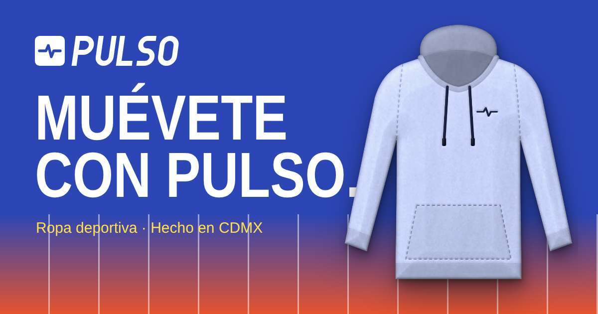

# PULSO — Performance Wear

Tienda en línea de ropa deportiva para la marca **PULSO**, diseñada en Ciudad de México.
Sitio estático (HTML, CSS y JavaScript sin dependencias) listo para publicarse en GitHub Pages.



## Qué incluye

| Página | Archivo | Contenido |
| --- | --- | --- |
| Inicio | `index.html` | Hero con línea de pulso en vivo (reacciona al cursor y al scroll), carriles por deporte, productos con filtros animados, tecnología con scroll horizontal, manifiesto, cuenta regresiva de lanzamiento y Club PULSO |
| Tienda | `tienda.html` | Filtros por línea, categoría, género, talla, color, precio, ofertas y favoritos; orden; URL compartible |
| Producto | `producto.html?id=…` | Galería con zoom y 3 vistas, cambio de color, tallas, cantidad, favoritos, barra de compra fija, recomendados y vistos recientemente |
| Pago | `checkout.html` | 3 pasos con validación (datos, envío, pago con tarjeta / OXXO / SPEI), resumen y confirmación |
| La marca | `marca.html` | Presentación de 18 diapositivas: qué es PULSO, su identidad (concepto, logo, color, tipografía, líneas, voz) y por qué el sitio está construido así. Se avanza con scroll, flechas del teclado, botones o deslizando en el celular |
| 404 | `404.html` | Página de error |

**Funciones globales:** carrito lateral con barra de envío gratis y códigos de descuento (`PULSO10`, `PRIMERKM`), favoritos, búsqueda (atajo `/`), vista de tallas, notificaciones, cursor personalizado, botones magnéticos, tarjetas con inclinación 3D, transiciones entre páginas y pantalla de carga. El carrito y los favoritos se guardan en el navegador (`localStorage`).

**Celular:** diseño pensado primero para pantalla chica: tarjetas en dos columnas, barra de herramientas fija en la tienda, filtros en panel, barra fija de compra, resumen de pago plegable y botones al alcance del pulgar.

**Accesibilidad:** navegación con teclado, foco visible, foco atrapado en paneles, textos alternativos y `prefers-reduced-motion` desactiva las animaciones.

## Ver en local

```bash
python3 -m http.server 8000
# abre http://localhost:8000
```

## Publicar en GitHub Pages

1. En el repositorio: **Settings → Pages**.
2. En *Source* elige **Deploy from a branch**, rama `main`, carpeta `/ (root)`.
3. Guarda. En uno o dos minutos el sitio queda en `https://jessicagarciam.github.io/BEQUEZ/`.

## Estructura

```
assets/
  css/styles.css        sistema de diseño completo
  js/data.js            catálogo (productos, colores, líneas, tecnologías)
  js/app.js             carrito, favoritos, búsqueda, cursor, transiciones
  js/home.js · shop.js · product.js · checkout.js · brand.js
  img/brand/            logotipo, isotipo, imagen para redes
  img/products/         108 renders de producto en WebP (12 productos × 3 colores × frente, espalda y detalle)
tools/generar-imagenes.py   logo y siluetas de las prendas (diseño, colores, estampados)
tools/render-producto.py    convierte las siluetas en renders con volumen, tela, luz y sombra
BRAND.md                manual de marca
```

## Editar productos

Todo el catálogo vive en `assets/js/data.js`. Para agregar un producto:

1. Añade su objeto a `PULSO_PRODUCTS` (id, nombre, precio, colores, tallas…).
2. Agrega su silueta y colores en `tools/generar-imagenes.py` y genera los renders:
   ```bash
   python3 tools/generar-imagenes.py /tmp/planos --flat
   python3 tools/render-producto.py /tmp/planos/assets/img/products assets/img/products
   ```
   Requiere `rsvg-convert`, `numpy`, `scipy` y `Pillow`.
3. Cuando tengas fotos reales de tus prendas, reemplaza los archivos con el mismo nombre:
   `assets/img/products/{id}--{color}--{front|back|detail}.webp` (900 × 1050 px, fondo transparente o gris claro).

## Cobrar pagos de verdad

El checkout es una demostración: valida los datos pero **no realiza cargos**. Para vender:

- **Stripe Checkout** o **Mercado Pago Checkout Pro**: crea la sesión de pago en un backend pequeño (por ejemplo una función de Vercel, Netlify o Cloudflare) y redirige desde `placeOrder()` en `assets/js/checkout.js`.
- Alternativa sin código: exporta el catálogo a Shopify y usa este diseño como tema.

## Tecnología

HTML5, CSS moderno (custom properties, `clamp()`, `:has()`), JavaScript sin frameworks. Fuentes: Big Shoulders Display e Instrument Sans (Google Fonts).
